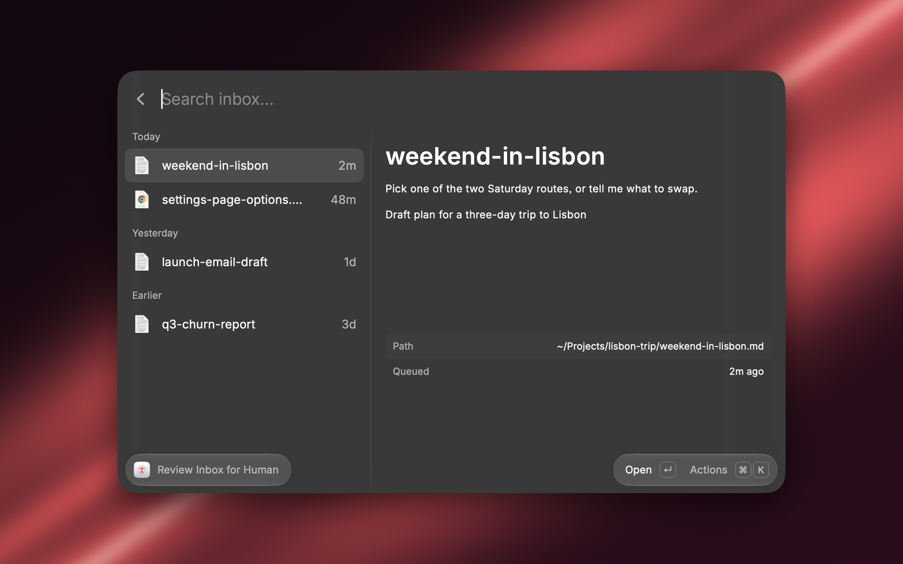

# inbox-for-human

inbox-for-human is a free skill for Claude Code, Codex, and other AI agents, with a Raycast extension for your Mac. When your agent needs you to review a plan, a report, or a draft, it adds the file to your inbox with a note on what it needs from you. Press your hotkey to see everything waiting on you, open each file, and archive it when you're done.

```sh
npx skills add jasonericsiegel/inbox-for-human
```

Then get the [Inbox for Human extension](https://www.raycast.com/jasoneric/inbox-for-human) from the Raycast Store.



## How it works

1. You ask Claude Code for a plan for a weekend in Lisbon. It writes the plan and adds it to your inbox: "Pick one of the two Saturday routes, or tell me what to swap."
2. You get on with your day. Meanwhile Codex, in another window, adds three mockups of a settings page for you to choose from.
3. Later, you press your hotkey. Both are waiting under Today, each with what the agent wants from you.
4. You open the plan, answer in chat, and press ⌘E to archive it.

## What goes in your inbox

Your agent adds a file when:

- It asks you to review, approve, or choose something it made: a plan before it builds, a report, a draft, or a few mockups.
- It finishes a document or a design for you.
- It has three or more questions for you, gathered in one file.
- You ask, for example: "**Add it to my inbox**", "**Let me review** the plan", or "Show me the options so I can **pick one**".

Quick answers stay in chat.

## Before you install

You need:

- A Mac with [Raycast](https://raycast.com/?via=jasoneric) (affiliate link). Your inbox lives in Raycast.
- Your agent running on your Mac, so it can add files there.
- Python 3. Most Macs with Claude Code or Codex already have it. If yours doesn't, macOS offers to install it the first time the skill runs.

| Where you use your agent | Works? |
|---|---|
| Claude Code in a terminal, VS Code, or JetBrains | Yes |
| The Claude desktop app, Code tab, Local session | Yes |
| Codex CLI, or Codex in the ChatGPT desktop app on Local | Yes. Codex may ask before it adds a file, since your inbox is outside your project folder. |
| Cursor, GitHub Copilot, Gemini CLI, and other agents that load skills | Should work. [Tell us](https://github.com/jasonericsiegel/inbox-for-human/issues/new/choose) if it doesn't. |
| Claude or ChatGPT in a browser or on a phone, and cloud sessions | No. There your agent runs on Anthropic's or OpenAI's computers, so it can't reach your Mac. |

## Install

1. Get [Inbox for Human from the Raycast Store](https://www.raycast.com/jasoneric/inbox-for-human).
2. Open your agent:
   - **Claude desktop app:** open the **Code** tab, choose a folder to work in (Documents is fine), and keep the session on **Local**.
   - **ChatGPT desktop app:** switch to **Codex** at the top of the window, choose a folder, and keep it on **Local**.
   - **Claude Code, Codex, or another agent in a terminal or code editor:** open it as usual.
3. Paste this in:

   > Install the inbox-for-human skill from https://github.com/jasonericsiegel/inbox-for-human

4. Start a new chat in the same place, so your agent loads the skill, and try it:

   > Write a packing list for a weekend away and add it to my inbox.

5. Open **Review Inbox for Human** in Raycast. Your packing list is at the top. To open your inbox from anywhere, give Review Inbox for Human a hotkey in Raycast's settings, under Extensions.

<details>
<summary>Install from a terminal instead</summary>

Copy the folder with git:

```sh
git clone https://github.com/jasonericsiegel/inbox-for-human ~/.claude/skills/inbox-for-human
```

That's the Claude Code folder. Codex, Cursor, GitHub Copilot, Gemini CLI, and most other agents read `~/.agents/skills/` instead.

Or use Vercel's `skills` installer, which needs [Node.js](https://nodejs.org) 22.20 or later and asks which agents to install for:

```sh
npx skills add jasonericsiegel/inbox-for-human -g
```

The installer sends anonymous install details (the repo, skill, and agent names) to skills.sh by default. Put `DISABLE_TELEMETRY=1` in front of the command to turn that off.

</details>

<details>
<summary>Install by hand</summary>

1. [Download this repository as a ZIP](https://github.com/jasonericsiegel/inbox-for-human/archive/refs/heads/main.zip) and unzip it.
2. Rename the folder from `inbox-for-human-main` to `inbox-for-human`.
3. Move it into `~/.claude/skills/` for Claude Code, or `~/.agents/skills/` for Codex and most other agents. These folders are hidden in your home folder: in Finder, press ⇧⌘G and paste the path. Create the folder if it's missing.
4. Start a new chat with your agent.

</details>

To remove it, ask your agent to remove the inbox-for-human skill, or delete the `inbox-for-human` folder from `~/.claude/skills/` or `~/.agents/skills/`. Uninstall the extension from Raycast's settings.

## Use it in Raycast

| Shortcut | Action |
|---|---|
| ⏎ | Open the file in its usual app |
| ⌘O | Open it with the app you chose in settings, or pick one |
| ⌘⇧F | Show it in Finder |
| ⌘E | Archive it |
| ⌘⇧E | Archive everything |
| ⌘⇧C | Copy its path |

Opening a file keeps it in your inbox until you archive it. If your agent adds an archived file again, it comes back with the new note.

**Open With (⌘O)** is the extension's one setting: the app ⌘O opens files in, Obsidian to start. Files inside an Obsidian vault open there, in a new tab. If Obsidian isn't installed, or a file isn't in a vault, ⌘O lets you pick an app. Clear the setting to pick an app every time.

## Better together

inbox-for-human works on its own. With [human-feedback](https://github.com/jasonericsiegel/human-feedback) installed too, a document your agent adds opens as a page where you leave notes beside the words, and your inbox links to that page.

## Where your inbox is kept

In a file on your Mac, `~/.agents/inbox-for-human/queue.json`, shared by all your agents and projects. Archived files are listed in `queue.archive.jsonl` beside it. Nothing is sent anywhere.

## License

MIT. See [LICENSE](LICENSE).

## Found a problem or have an idea?

[Open an issue](https://github.com/jasonericsiegel/inbox-for-human/issues/new/choose). Ideas are welcome. Code contributions aren't accepted; see [CONTRIBUTING.md](CONTRIBUTING.md). Changes are listed in [CHANGELOG.md](CHANGELOG.md).
